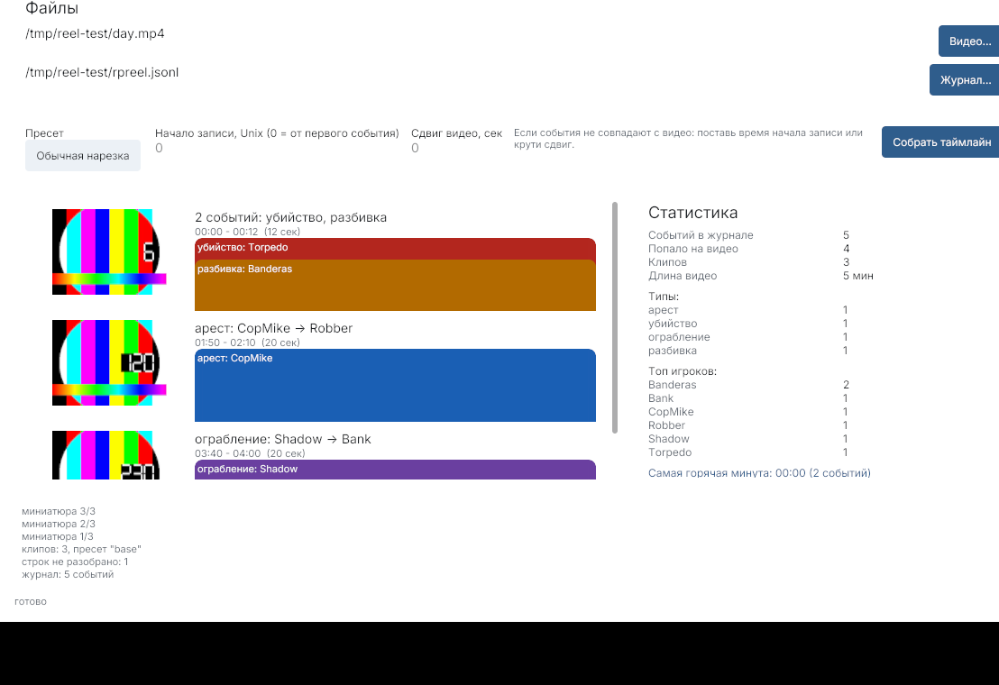

[**Русский**](README.md) | [English](README.en.md)

# RP Reel

Нарезка моментов RP-сервера из видеозаписи. Плагин пишет журнал событий (убийства, разбивки, аресты, ограбления), приложение кладет их на таймлайн видео и одной кнопкой вырезает клипы - без перекодирования, даже 4K.



## Для чего

- серверный админ выкладывает «момент дня» в Discord/VK/Telegram;
- стример собирает подборку из записи за вечер;
- судья разбирает инцидент: клик по метке - и кадр перед событием.

## Как работает

1. **Плагин на сервер** пишет `rpreel.jsonl`: время, тип события, игроки. Готовые включения для [SA-MP](plugins/samp/rpreel.inc), [RAGE MP](plugins/ragemp/reel.js) и [FiveM](plugins/fivem/reel.lua) - около 20 строк каждое.
2. **Запись видео**: OBS на той же машине, что и сервер, тогда часы совпадают. Если машины разные - в приложении есть сдвиг.
3. **Таймлайн**: приложение читает журнал и видео, рисует ленту с миниатюрами и цветными метками событий, справа - статистика: топ игроков, типы, самая горячая минута.
4. **Ролик**: ffmpeg вырезает окна вокруг событий (`-c copy`, без перекодирования) и склеивает их в `reel.mp4`. Пишутся `events.srt` с подписями, `report.txt` и `digest.json`.

## Установка

1. Скачай [последний релиз](https://github.com/hilsetapp/rp-reel/releases/latest/download/rp-reel-windows.zip) и распакуй в любую папку.
2. Поставь [ffmpeg](https://ffmpeg.org/download.html) и добавь его в PATH (без ffmpeg приложение скажет об этом прямо в статусе).
3. Запусти `rp-reel.exe`.

Windows 10/11. Приложение не требует установки, не пишет в реестр, не лезет в сеть: всё считается на твоей машине.

## Быстрый старт

1. На сервере: `#include <rpreel>` в гамемоде, `Reel_Open()` в `OnGameModeInit`, `Reel_Kill(killerid, victimid, reason)` в `OnPlayerDeath` (для SA-MP; для RAGE MP и FiveM готовые подписки уже внутри).
2. Запиши вечер в OBS, скопируй `rpreel.jsonl` к себе.
3. В приложении: кнопки «Видео...» и «Журнал...», далее «Собрать таймлайн».
4. Кликни по клипу - увидишь события внутри, «Показать в плеере» откроет VLC на нужной секунде.
5. «Вырезать ролик» - готово, папка откроется сама.

Можно сразу из командной строки:

```
rp-reel.exe -video day.mp4 -log rpreel.jsonl
```

## Синхронизация времени

Если метки не совпадают с видео, есть два способа:
- **«Начало записи, Unix»** - время старта записи в секундах (OBS показывает в свойствах файла, либо `date +%s` на сервере в момент старта);
- **«Сдвиг видео, сек»** - если метки бегут впереди или позади видео, крути это поле.

По умолчанию первое событие считается началом видео.

## Галерея пресетов

Пресет - окно до/после события и лимит клипов. Встроенные:

| Пресет | Окно | Клипы | Для чего |
| --- | --- | --- | --- |
| Обычная нарезка | 10+10 сек | все | универсально |
| Twitch Shorts | 5+7 сек | 12 | короткие вертикальные ролики |
| Дайджест дня | 8+12 сек | 40 | вечер целиком в одном файле |
| Вертикаль 9:16 | 6+8 сек | 10 | VK Клипы и Reels (с перекодированием) |

Свой пресет - json-файл в папку `templates` рядом с exe, формат в [`internal/template/presets/README.md`](internal/template/presets/README.md).

## Командная строка

```
rp-reel-cli -log rpreel.jsonl -video day.mp4 -video-ts 1729440000
rp-reel-cli -log rpreel.jsonl -video day.mp4 -preset discord-digest
rp-reel-cli -log rpreel.jsonl -video day.mp4 -no-cut   # только отчет и план
```

Флаги: `-log` журнал, `-video` запись, `-video-ts` начало записи (Unix, сек), `-offset` сдвиг видео (сек), `-preset` пресет, `-out` папка результата (по умолчанию `reel-out`), `-no-cut` без ffmpeg-вырезки, `-version`.

## Что внутри

- Go + Gio: один exe, без рантайма;
- нарезка `ffmpeg -c copy`: ключевые кадры, мгновенно, без нагрузки на GPU;
- миниатюры кадров для таймлайна делает сам ffmpeg;
- приватность: журнал и видео никуда не уходят.

## Планы

- карта событий по координатам из журнала;
- автосинхронизация по звуку (выстрелы/взрывы);
- готовые ресурсы для серверов: MTA, Oxen.

## Лицензия

MIT. ffmpeg нужен отдельно, его лицензия - [вот тут](THIRD_PARTY_NOTICES.md).

## Контакты

Issues читает, на RU отвечает. Серверные идеи и пресеты принимаются.
